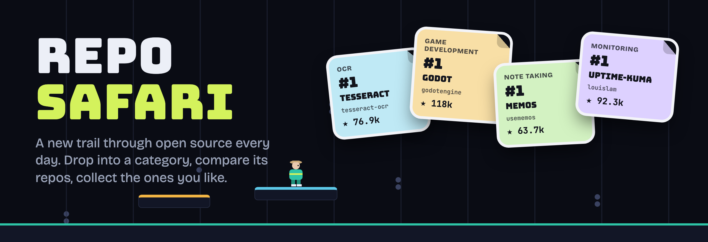
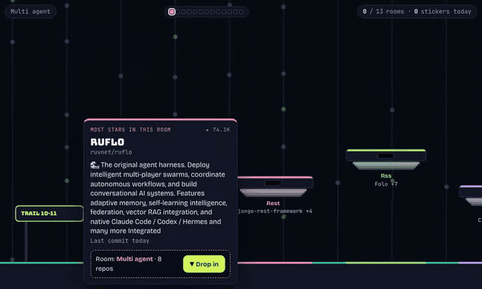
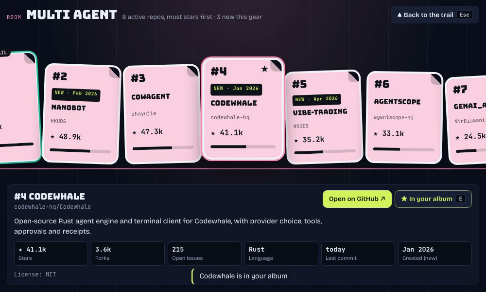
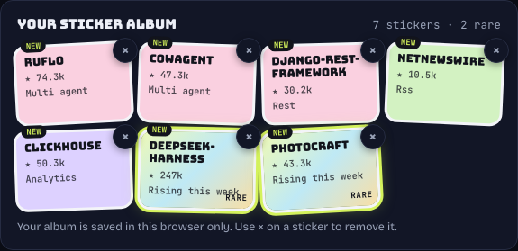
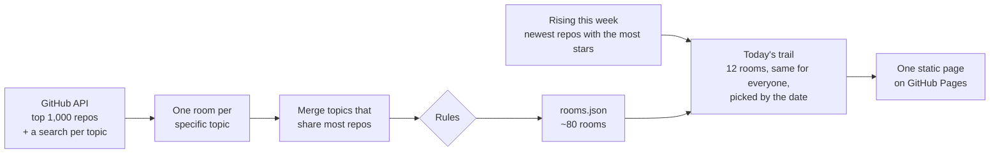

<p align="center">
  <a href="https://w20labs.github.io/repo-safari/"></a>
</p>

<p align="center">
  <a href="https://w20labs.github.io/repo-safari/"></a>
</p>

<p align="center">
  <a href="https://github.com/w20labs/repo-safari/actions/workflows/pages.yml"></a>
  <a href="https://github.com/w20labs/repo-safari/actions/workflows/ci.yml"></a>
  <a href="LICENSE"></a>
  
</p>

**Repo Safari is a tiny daily game for finding open-source projects worth knowing about.**
Every day there's a new trail of about a dozen categories (OCR, vector databases, game engines, note-taking apps…).
Walk the trail, drop into a category, and its leading active repos are waiting on the wall as stickers, ranked by stars.
Keep the ones you like. No sign-up, no quiz, nothing to lose. A walk takes about three minutes.

<p align="center">
  
</p>

## How to play

| | Keyboard | Phone |
|---|---|---|
| Walk | <kbd>←</kbd> <kbd>→</kbd> | ◀ ▶ |
| Jump, then again in the air for a double jump | <kbd>Space</kbd> | ▲ |
| Drop into a category's room | <kbd>↓</kbd> | ▼ |
| Save a sticker to your album | <kbd>E</kbd> | ★ |
| Open the repo on GitHub | <kbd>Enter</kbd> | ▼ in a room |
| Climb back out | <kbd>Esc</kbd> | ▲ in a room |

1. **Walk the trail.** Each platform is a category. Stand on one to see its best-known repo.
2. **Drop in.** The room shows up to eight selected active repos from that category as stickers, most stars first, with forks, open issues, language and last commit. A 🤝 badge shows how many pull requests from outside contributors were merged in the last 90 days: a project other people actually contribute to, not just one that's still being pushed to.
3. **Collect.** Save the ones you want to remember. They go into your sticker album.
4. **Reach the end.** This week's rising repos sit on a high platform at the end of the trail. Getting there takes a double jump, and their stickers are rare.
5. **Mix (experiment).** The Idea Shower card at the top offers 3 repos, each with what it does: your stickers, or random repos from this week's trail. Press **Mix these 3**, shuffle them, or **Choose repos** (your stickers are one tap away, or search this week's repos), and turn them into three product ideas: useful, unexpected and ridiculous. Copy an idea, copy a ready-made prompt for your coding agent, or share the mix as a link.
6. **Publish and star (built, not switched on yet).** The idea board lets you publish one of your generated ideas, share its permanent link and star other people's ideas with your GitHub account. Each week, the idea with the most new stars is picked for a community prototype. See [docs/idea-board.md](docs/idea-board.md).

<table>
  <tr>
    <td width="58%"></td>
    <td width="42%"></td>
  </tr>
  <tr>
    <td align="center"><sub>Inside a room: compare a category's leading active repos</sub></td>
    <td align="center"><sub>Your album: rare stickers are available to collect on this week's trail</sub></td>
  </tr>
</table>

## Built by rules, not by hand

Nobody picks the categories. A pipeline builds them from GitHub's own topics every week, and a set of rules decides what makes the cut.



| Rule | Why |
|---|---|
| A commit in the last 6 months, not archived | The trail is about what's alive now |
| 🤝 counts merged PRs from outside the core team (not owners, members, collaborators or bots) over 90 days | A lone maintainer keeps a repo active; outside PRs show a community |
| The repo is about the topic (name or opening words), or carries two of its topics | Keeps out repos that just mention a word |
| At most two repos from the same owner | A room compares alternatives, not one team's projects |
| No room named after one of its own repos | "Vite" would just be Vite's family |
| Rooms that overlap are merged, near-identical names are folded together | No two rooms with the same content |
| A safety filter for exploits, malware, piracy, people-tracking, leaked prompts, paid-AI bypasses and adult content | It's a game people share |

The rules live in [`scripts/build-rooms.ts`](scripts/build-rooms.ts) and [`server/rising-filter.ts`](server/rising-filter.ts). Grouping by topics isn't perfect; if a room looks wrong, [tell us](https://github.com/w20labs/repo-safari/issues/new?template=room.yml).

## Your data

You don't need an account to play. Your sticker album is saved in your own browser (`localStorage`) and never leaves it, and so do the days you played (for your streak). Clearing your browser data clears both.

**Idea Shower:** the 3 repo names you pick are sent to our server and to Anthropic to generate ideas. Shared links contain the mix itself in the URL and aren't stored by us. We collect no email or other personal data.

**Idea board (when it's switched on):** browsing and generating stay anonymous. Publishing or starring needs GitHub sign-in (public profile only): we store your GitHub account number and handle, a session, and which ideas you starred. Generated ideas are kept for 24 hours so you can publish one, then deleted. Publishing makes that idea, its source repos and your GitHub handle public. Board stars aren't GitHub stars.

To learn whether people actually play, the site counts visits with [GoatCounter](https://www.goatcounter.com): no cookies and nothing that identifies you. Besides page views it counts six anonymous events: a room opened, a sticker saved (which repo), the end of the trail reached, Share pressed, the length of your streak on the first walk of each day, and which W20 Labs link was clicked. The Idea Shower adds fifteen more, each at most once per visit: card shown, card shuffled, Choose repos opened, machine opened, 3 ingredients picked, which way it was opened (the card, Shuffle in the machine or the 3-sticker nudge), ideas asked for, ideas generated, generated again, idea copied, build prompt copied, mix shared, and a shared mix opened. The mix itself is never counted. The idea board, when it's switched on, adds a few more (board opened, a view looked at, sign-in started and finished, an idea published, starred or shared): never who you are or what an idea says. Board stars themselves are stored with your GitHub account, as [docs/idea-board.md](docs/idea-board.md#privacy-and-retention) explains.

## Run it locally

You need **Node.js 24** (`nvm use` reads `.nvmrc`).

```sh
npm install
GITHUB_TOKEN=$(gh auth token) npm run build-safari -- https://w20labs.github.io/repo-safari/ --site _site
open _site/index.html
```

| Command | What it does |
|---|---|
| `npm run build-rooms` | Rebuild the rooms from the GitHub API (`-- --cached` reuses the last fetch) |
| `npm run refresh-rising` | Refresh this week's rising repos |
| `npm run community` | Add the 🤝 outside-PR counts to the current rooms and rising repos (needs `GITHUB_TOKEN`) |
| `npm run build-safari -- <url> --site _site` | Build the page into `_site/` (`IDEAS_URL=mock` adds the Idea Shower with canned ideas) |
| `npm run typecheck` / `npm test` / `npm run test:e2e` | Type-check, unit tests, browser tests |

The Idea Shower's server is one Cloudflare Worker in [`worker/`](worker); [docs/idea-shower-results.md](docs/idea-shower-results.md) covers running it, launching it and reading the results. The idea board runs in the same Worker with Cloudflare D1; `npm run board-preview` starts a local preview with synthetic data and no paid calls, and [docs/idea-board.md](docs/idea-board.md) covers setup, rules, owner operations and activation.

Every push to `main` deploys through [`.github/workflows/pages.yml`](.github/workflows/pages.yml), and on Mondays it refreshes the rooms and rising repos first.

## Contributing

Ideas, bug reports and "this room is weird" reports are very welcome: [open an issue](https://github.com/w20labs/repo-safari/issues/new/choose).

Pull requests are limited to the project's collaborators, and every change to `main` needs passing checks and a maintainer's review. See [CONTRIBUTING.md](CONTRIBUTING.md) for how to get involved, and [SECURITY.md](SECURITY.md) to report a vulnerability privately.

## License

[MIT](LICENSE). The bundled fonts are under the SIL Open Font License; see [assets/fonts](assets/fonts/README.md).
Repo names, descriptions and numbers come from the GitHub API. Repo Safari is an independent project and isn't affiliated with GitHub.

<sub>This repository started as <a href="docs/last-commit-standing.md">Last Commit Standing</a>, a quiz platformer. Its code is still here.</sub>
